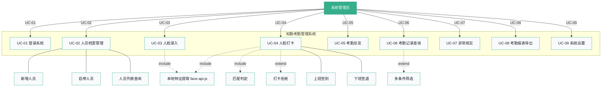
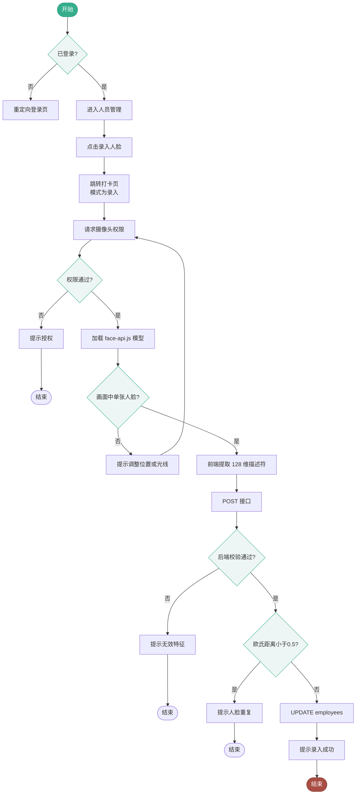
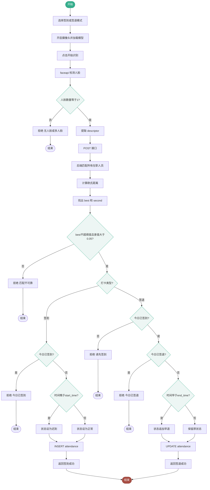
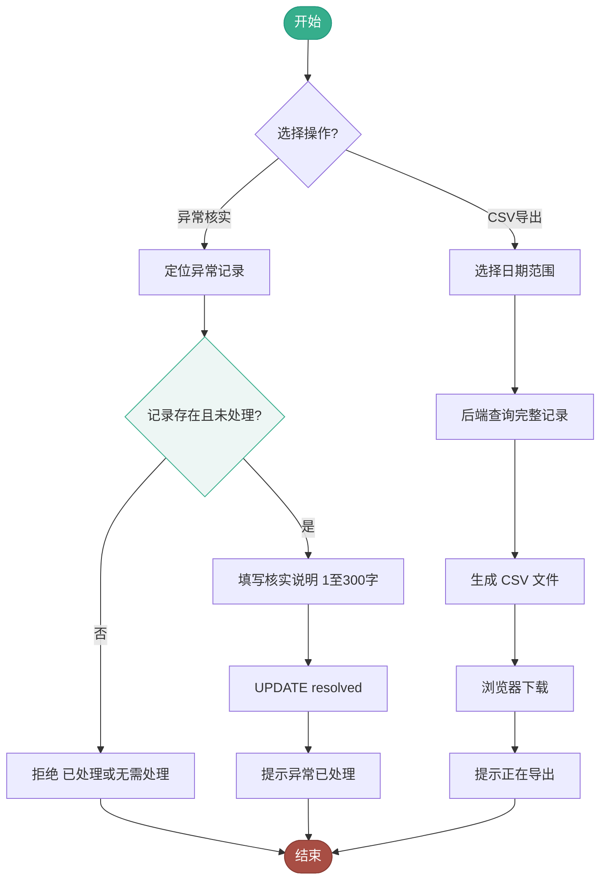

# 第一步 · 场景建模（Scenario Modeling）

> **面向对象分析（OOA）第一步**：从需求描述中识别核心场景，建立"系统边界 → 用例 → Story → 对象"的可追溯链条。
> 方法：文字叙述 + UML 用例图 + 用例模板 + 活动图 + Story List + 对象识别
> 生成日期：2026-11-03

---

## 1. 场景叙述（文字说明）

### 1.1 核心业务场景

#### 场景 A：管理员登录与日常巡检

> 周一早上 8:55，管理员小周打开电脑，启动浏览器访问考勤系统。输入账号密码登录后，首页的"考勤总览"立即呈现：今日应到 24 人，已签到 18 人，迟到 2 人，尚未签到 4 人。小周点击"迟到 2 人"直接看到名单，然后切换到"考勤记录"页面确认异常原因。这一日常巡检在 3 分钟内完成，系统全程流畅。

#### 场景 B：新员工入职建档 + 人脸录入

> 新同事小李入职 HR 部。管理员小周进入"人员管理"，点击"新增人员"填写：工号 ZQ1025、姓名李晴、部门人力资源部、职位人事专员。保存后返回人员列表，小李一行标记为"未录入人脸"。小周点击"录入人脸"进入打卡页，把摄像头转向小李，小李坐下正对镜头。小周点击"开启摄像头"，系统加载 face-api.js 模型（约 4 秒）。画面清晰，小周点击"采集并保存"——系统提取 128 维描述符，与已录的 23 人特征比对欧氏距离均 > 0.5，保存成功。小李档案现在标记为"已录入人脸"。

#### 场景 C：人脸打卡（上班签到）

> 周二早上 9:05，小李走到公司前台的打卡电脑。摄像头已开启在"上班签到"模式。小李站好正对镜头，画面中仅他一人。点击"开始识别"，系统提取描述符并向后端 `/api/recognize` 请求。后端遍历 24 人的 descriptor 计算欧氏距离：小李的最佳距离 0.38，次佳 0.72，阈值 0.50——匹配成功。但时间是 09:05，超过了 09:00 的上班时间，状态标记为"迟到"。打卡机弹出"李晴，签到成功 · 匹配距离 0.382 · 09:05:12"。

#### 场景 D：人脸打卡（下班签退）

> 周二下午 18:30，小李走到前台打卡。点击"下班签退"模式识别成功。系统检查：今日已签到 ✓，今日未签退 ✓。时间 18:30 不早于 18:00，状态保持"迟到"（上午的迟到不因准时下班而自动修正）。UPDATE `check_out = 18:30`，签退成功。

#### 场景 E：异常核实与月末导出

> 月末 30 号，小周进入"考勤记录"查询本月数据。发现小李周二迟到，点击"处理异常"填写"已核实，地铁延误"，标记为已处理——但原始状态"迟到"**保留不变**。然后点击"导出报表"，浏览器下载 `attendance-2026-11-01~2026-11-30.csv`，Excel 打开中文表头正常无乱码。

---

## 2. 用例图（UML Use Case Diagram）

### 2.1 顶层用例图



### 2.2 用例角色与系统边界

```
┌────────────────────────────────────────────────────────────────────┐
│                        系统边界（System Boundary）                    │
│  ┌──────────────────────────────────────────────────────────────┐  │
│  │                                                              │  │
│  │    ┌─────────┐     ┌─────────┐     ┌─────────┐              │  │
│  │    │ 登录    │     │ 人员    │     │ 人脸    │   ...更多    │  │
│  │    │ 认证    │     │ 管理    │     │ 打卡    │              │  │
│  │    └─────────┘     └─────────┘     └─────────┘              │  │
│  │                                                              │  │
│  │    ┌─────────────────────────────────────────────┐          │  │
│  │    │ 外部组件（不属于本系统）：                     │          │  │
│  │    │ 浏览器 · face-api.js · 摄像头硬件 · H2 DB     │          │  │
│  │    └─────────────────────────────────────────────┘          │  │
│  └──────────────────────────────────────────────────────────────┘  │
│                                                                  │
│  ┌──────────┐                                                     │
│  │ 系统管理 │ ← 唯一参与者（Actor）                                │
│  └──────────┘                                                     │
└────────────────────────────────────────────────────────────────────┘
```

---

## 3. 用例模板（Use Case Specification）

### 模板说明

每条用例遵循 **UML Use Case Specification** 标准模板：

| 字段 | 含义 |
|------|------|
| 用例名称 | 动词开头，简洁描述目标 |
| 参与者 | 触发该用例的角色 |
| 前置条件 | 执行前必须满足的状态 |
| 后置条件 | 成功执行后保证的状态 |
| 主流程 | 典型成功路径，编号 1→N |
| 替代流程 | 异常/分支路径，编号 N.a / N.b |
| 业务规则 | 与主流程交织的约束条件 |

---

### UC-01 登录系统

| 字段 | 内容 |
|------|------|
| 用例名称 | 登录系统 |
| 参与者 | 系统管理员 |
| 前置条件 | 1. 管理员凭证已通过环境变量配置<br>2. 当前无有效 Session 或 Session 已过期 |
| 后置条件 | 1. Session 创建<br>2. 管理员进入工作台首页 |

**主流程**：
1. 管理员访问 `/login.html`
2. 表单自动渲染，用户名默认 `admin`
3. 管理员输入密码 → 点击"登录"
4. Spring Security 拦截 `/login` POST，BCrypt 编码比对
5. 比对成功 → 创建 Session → 302 重定向 `/`

**替代流程**：
- 4a. BCrypt 比对失败 → 返回 `?error` 参数 → 登录页显示"账号或密码错误"
- 4b. CSRF Token 缺失/错误 → 返回 403
- 4c. 密码为空 → 浏览器 HTML5 校验拦截

---

### UC-02 人员档案管理

**UC-02a 新增人员**

| 字段 | 内容 |
|------|------|
| 前置条件 | 已登录，管理员角色 |
| 后置条件 | `employees` 表 INSERT 一条记录，`active = TRUE` |

**主流程**：
1. 管理员进入"人员管理"→ 点击"新增人员"
2. 弹出模态框，填写：工号、姓名、部门、职位
3. 前端表单校验 HTML5 required + maxlength
4. 提交 → POST `/api/employees` + JSON body + CSRF Token
5. 后端校验字段（长度、非空）
6. 后端校验工号唯一性（UNIQUE 约束）
7. INSERT INTO employees → 返回 204 OK

**替代流程**：
- 5a. 字段超长 → `IllegalArgumentException` → 400 + 具体提示
- 6a. 工号重复 → `DataIntegrityViolationException` → 400 + "工号已存在"

---

### UC-03 人脸录入（核心）

| 字段 | 内容 |
|------|------|
| 前置条件 | 1. 已登录<br>2. 目标人员存在且在职（`active=TRUE`）<br>3. 管理员已取得员工知情同意 |
| 后置条件 | `employees.descriptor` 字段写入 128 维 JSON 描述符 |

**主流程**：
1. 管理员在人员列表点击"录入人脸"按钮
2. 跳转打卡页，模式自动切换为"人脸录入"并显示员工信息
3. 点击"开启摄像头" → 浏览器请求 `getUserMedia({video: true})`
4. face-api.js 加载三个模型：TinyFaceDetector + Landmark68 + RecognitionNet
5. 管理员让员工正对镜头，画面中单张人脸清晰
6. 点击"采集并保存"
7. 前端调用 `faceapi.detectAllFaces().withFaceLandmarks().withFaceDescriptors()`
8. 校验 `faces.length === 1` ✓
9. 提取 `faces[0].descriptor` → POST `/api/employees/{id}/face`
10. 后端校验：128 维、值域 [-2, 2]、归一化 norm ≥ 0.01
11. 后端遍历已录人脸，计算欧氏距离 `sqrt(Σ(a[i]-b[i])²)`
12. 所有欧氏距离 ≥ 0.5（无重复）
13. UPDATE `descriptor = json` WHERE id = ? AND active = TRUE
14. 返回成功 → Toast "人脸档案已保存" → 跳转人员管理

**替代流程**：
- 3a. 摄像头权限被拒 → Toast "摄像头访问被拒绝"
- 6a. 画面无人脸 → "未检测到清晰人脸"
- 6b. 画面多张脸 → "检测到多张人脸"
- 10a. 描述符无效 → "无效的人脸特征，请重新采集"
- 12a. 欧氏距离 < 0.5 与已有脸重复 → "此人脸已被其他人员录入"
- 13a. 人员已停用 → "人员不存在或已停用"

**业务规则**：欧氏距离公式 `d = √(Σᵢ₌₀¹²⁷ (aᵢ - bᵢ)²)`，阈值判定范围 [0.30, 0.60]，默认 0.50

---

### UC-04 人脸打卡（核心）

| 字段 | 内容 |
|------|------|
| 前置条件 | 1. 已登录<br>2. 摄像头可用<br>3. 员工已录入人脸且在职 |
| 后置条件 | `attendance` 表新增/更新记录 |

**主流程（上班签到）**：
1. 管理员选择"上班签到"标签
2. 点击"开启摄像头" → 模型加载 → 画面就绪
3. 员工正对镜头，单张脸清晰
4. 点击"开始识别"
5. 前端提取描述符 → POST `/api/recognize {descriptor, action:"in"}`
6. 后端遍历所有 `active=TRUE AND descriptor IS NOT NULL` 的员工
7. 计算欧氏距离，找出 `best`（最小）和 `second`（次小）
8. 校验：`best ≤ threshold` 且 `second - best ≥ 0.05`
9. 查询今日该员工 `attendance` 记录（行锁 FOR UPDATE）
10. 确认今日无签到记录 ✓
11. 取当前时间 `LocalDateTime.now(Asia/Shanghai)`
12. 与设置的 `start_time` 对比：晚于 → 状态="迟到"；否则 → "正常"
13. INSERT INTO attendance(employee_id, attendance_date, check_in, status, source, distance)
14. 返回 `{name, distance, message, time}` → 前端渲染结果框

**主流程（下班签退）**：
1-8. 同上，匹配成功
9. 查询今日 attendance 记录
10. 确认已签到（记录存在）✓
11. 确认未签退（`check_out IS NULL`）✓
12. 与设置的 `end_time` 对比：早于 → 状态追加"早退"
13. UPDATE attendance SET check_out=?, status=? WHERE employee_id=? AND attendance_date=?
14. 返回成功

**替代流程（UC-04r 打卡拒绝）**：

| 编号 | 拒绝场景 | 拒绝条件 | 返回消息 |
|------|----------|----------|----------|
| 4r-1 | 无人脸 | `faces.length === 0` | "未检测到清晰人脸" |
| 4r-2 | 多人脸 | `faces.length > 1` | "检测到多张人脸" |
| 4r-3 | 匹配超阈值 | `best > threshold` | "未找到可靠匹配" |
| 4r-4 | 模糊匹配 | `second - best < 0.05` | "未找到可靠匹配" |
| 4r-5 | 重复签到 | `attendance` 已存在 | "今日已签到" |
| 4r-6 | 未签到即签退 | 记录不存在 | "请先完成上班签到" |
| 4r-7 | 重复签退 | `check_out IS NOT NULL` | "今日已签退" |

---

## 4. 活动图（UML Activity Diagram）

### 4.1 活动图 A：人脸录入活动



### 4.2 活动图 B：人脸打卡活动（完整）



### 4.3 活动图 C：异常核实与 CSV 导出



---

## 5. Story List（V1.0 用例映射 ✅ 已实现）

### 5.1 V1.0 Story 与用例关联（全部交付）

| Story ID | 用户故事 | 用例 | 优先级 | 归属 |
|----------|----------|------|--------|------|
| ST-01 | 作为管理员，我希望通过账号密码登录系统 | UC-01 | Must | V1.0 ✅ |
| ST-02 | 作为系统，我希望启用 CSRF 保护 | UC-01 | Must | V1.0 ✅ |
| ST-03 | 作为系统，我希望未登录 API 返回 401 | UC-01 | Must | 1 |
| ST-04 | 作为管理员，我希望能退出登录 | UC-01 | Must | 1 |
| ST-06 | 作为管理员，我希望新增团队成员 | UC-02a | Must | 1 |
| ST-09 | 作为管理员，我希望停用/启用成员 | UC-02b | Must | 1 |
| ST-11 | 作为管理员，我希望录入员工人脸 | UC-03 | Must | 1 |
| ST-13 | 作为系统，我希望自动检查人脸重复 | UC-03 | Must | 1 |
| ST-15 | 作为员工，我希望刷脸完成上班签到 | UC-04s | Must | 1 |
| ST-16 | 作为员工，我希望刷脸完成下班签退 | UC-04o | Must | 1 |
| ST-17 | 作为系统，我希望匹配超阈值时拒绝 | UC-04m | Must | 1 |
| ST-18 | 作为系统，我希望模糊匹配时拒绝 | UC-04m | Must | 1 |
| ST-25 | 作为管理员，我希望首页看到今日统计 | UC-05 | Must | 1 |
| ST-26 | 作为管理员，我希望按日期查询记录 | UC-06 | Must | 1 |
| ST-28 | 作为管理员，我希望填写异常核实说明 | UC-07 | Must | 1 |
| ST-31 | 作为管理员，我希望配置考勤规则 | UC-09 | Must | 1 |
| ST-34 | 作为管理员，我希望导出 CSV 报表 | UC-08 | Must | 1 |

---

## 6. 对象识别（语法分析法 + 领域分析法）

### 6.1 方法说明

面向对象分析中识别候选对象有两种常用方法：

| 方法 | 核心思路 | 适用场景 |
|------|----------|----------|
| **语法分析（Noun Analysis）** | 从需求文本中提取**名词**作为候选对象 | 需求文本较规范时 |
| **领域分析（Domain Analysis）** | 从核心业务概念出发，用"是什么/做什么/属于谁"追问 | 业务领域清晰时 |

本项目两种方法结合使用，然后交叉验证。

---

### 6.2 语法分析法结果

> 从用例模板和 Story 文本中**提取名词**，逐个判断是否为"问题空间中的独立事物"：

| 名词 | 是否候选对象 | 归类 | 理由 |
|------|-------------|------|------|
| 管理员 | ✅ 否 | **Actor** | 参与者，不是系统内对象 |
| 员工 | ✅ **是** | **核心对象** | 考勤的主体 |
| 人员档案 | ✅ 是 | ↓ 合并 | 员工是人员档案的实体 |
| 考勤记录 | ✅ **是** | **核心对象** | 打卡产出的记录 |
| 签到 | ✅ 否 | 考勤记录的**状态** | 不是独立对象 |
| 签退 | ✅ 否 | 考勤记录的**状态** | 不是独立对象 |
| 异常 | ✅ 否 | 考勤记录的**状态** | 不是独立对象 |
| 人脸特征 / descriptor | ✅ **是** | 属性 | 员工的属性（128维向量） |
| 摄像头 | ❌ 否 | 外部硬件 | 不属于问题空间 |
| face-api.js | ❌ 否 | 外部库 | 技术组件，不作为业务对象 |
| 匹配距离 | ❌ 否 | 属性 | 考勤记录的属性 |
| 考勤设置 / 规则 | ✅ **是** | **核心对象** | 独立可配置的业务规则 |
| 报表导出 | ❌ 否 | 操作 | 不是对象 |
| 部门 | ❌ 否 | 属性 | 员工的属性 |
| 工号 | ❌ 否 | 属性 | 员工的属性 |
| Session | ❌ 否 | 技术组件 | 不属于业务领域 |

**初步候选对象集合（语义去重后）**：
```
Candidate Class = { Employee, AttendanceRecord, AttendanceSettings, FaceDescriptor }
```

---

### 6.3 领域分析法结果

> 核心业务追问链：

```
业务本质：考勤 = 谁(Employee) 在什么时间(Date) 做了什么事(签到/签退) → 产生什么结果(AttendanceRecord)
                ↓                        ↑
         FaceDescriptor              受 AttendanceSettings 约束
         (128维特征向量)             (上/下班时间 + 识别阈值)
```

| 追问 | 结论 |
|------|------|
| 考勤的主体是谁？ | **员工（Employee）** |
| 员工的什么信息能识别他？ | 人脸特征 **FaceDescriptor**（128维向量） |
| 一次打卡产生什么？ | **考勤记录（AttendanceRecord）** |
| 考勤记录被什么规则约束？ | **考勤设置（AttendanceSettings）** |
| 多个实体之间的协作中心是谁？ | **考勤服务（AttendanceService）** — 这不是业务对象，是协调者 |

**领域候选对象集合**：
```
Domain Class = { Employee, AttendanceRecord, AttendanceSettings, FaceDescriptor }
```

---

### 6.4 对象识别汇总

两种方法**完全一致**，得到稳定的领域对象集合：

| 对象 | 说明 | 识别来源 |
|------|------|----------|
| **Employee（员工）** | 被考勤的主体，拥有人员档案和人脸特征 | 语法分析 + 领域分析 |
| **AttendanceRecord（考勤记录）** | 每日一次的打卡产出，记录签到/签退时间和状态 | 语法分析 + 领域分析 |
| **AttendanceSettings（考勤设置）** | 系统规则：上/下班时间 + 识别阈值 | 语法分析 + 领域分析 |
| **FaceDescriptor（人脸特征）** | Employee 的属性对象（128维向量，JSON 存储） | 属性级分析 |

**注意**：`FaceDescriptor` 是 `Employee` 的属性（CLOB 字段），设计上不作为独立类出现，而是 Employee 的一个复杂属性。因此最终**顶层业务类只有 3 个**：

```
Final Class Set = { Employee, AttendanceRecord, AttendanceSettings }
```

**被排除的名词**：
- ❌ 管理员 → Actor，不是系统内业务对象
- ❌ 摄像头、face-api.js → 外部技术组件
- ❌ Session、CSRF、BCrypt → 安全框架组件
- ❌ 部门、工号、匹配距离 → 简单属性
- ❌ 签到、签退、迟到 → 状态/操作，不是对象

---

## 7. 场景建模输出总结

```
┌────────────────────────────────────────────────────────────┐
│                OOA 第一步 · 场景建模输出                      │
│                                                            │
│  ✅ 5 个核心业务场景叙述（A~E）                               │
│  ✅ 1 张顶层 UML 用例图（9 个用例 + <<include>>/<<extend>>）  │
│  ✅ 5 条详细用例模板（UC-01, 02a, 03, 04, 07）               │
│  ✅ 3 张 UML 活动图（人脸录入 / 人脸打卡 / 异常核实+导出）    │
│  ✅ V1.0 Story → 用例映射（41 条 Story，Must + Should）     │
│  ✅ 面向对象识别：                                            │
│     - 语法分析法（名词提取）→ 3 类                           │
│     - 领域分析法（业务追问）→ 3 类                           │
│     - 交叉验证 → 一致                                        │
│     Final = { Employee, AttendanceRecord, AttendanceSettings }│
│                                                            │
│  ➡️ 下一步：基于这 3 个类进行静态建模                        │
└────────────────────────────────────────────────────────────┘
```

---

**文档版本**：v1.0
**生成日期**：2026-11-03
**所属阶段**：OOA 第一步 · 场景建模
