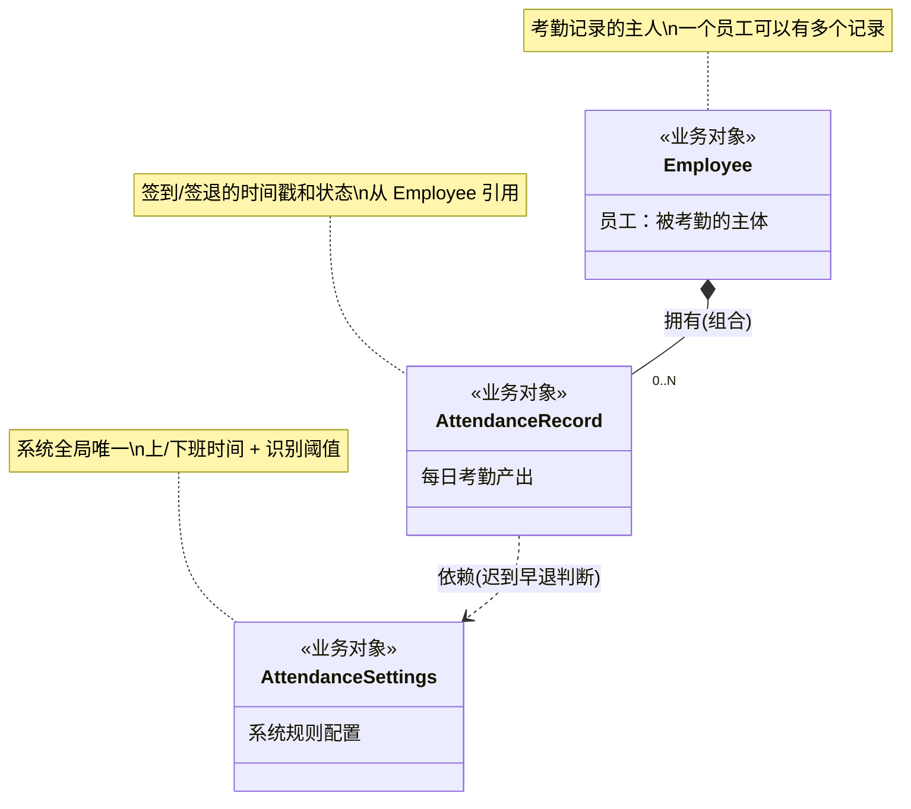
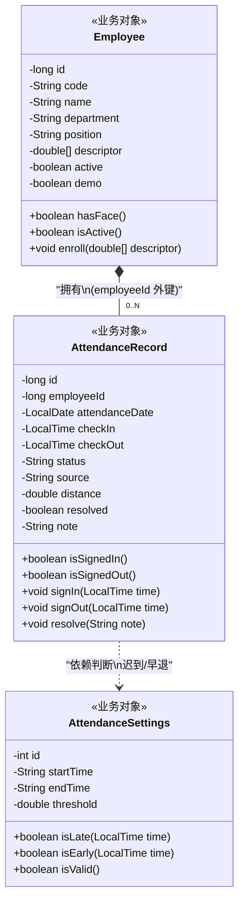
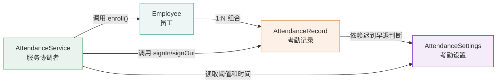

# 第二步 · 静态建模（Structural Modeling）

> **面向对象分析（OOA）第二步**：基于场景建模识别的对象，通过领域分析确定类之间的关系、属性、方法，输出完整类图和 CRC 卡片。
> 方法：领域分析 → 类关系图 → 类图 → CRC 卡片
> 生成日期：2026-11-03

---

## 1. 领域分析补全

### 1.1 场景建模结果回顾

场景建模已识别出 3 个核心业务类：
```
Employee, AttendanceRecord, AttendanceSettings
```

静态建模需要进一步补充：
1. **每个类有什么属性**？
2. **每个类有什么行为（方法）**？
3. **类之间是什么关系**？
4. **是否有遗漏的类**？

### 1.2 属性提取（语法分析续）

> 从用例模板和数据库表结构中提取每个类的属性：

#### Employee 类属性

| 来源 | 提取属性 | 类型 | 约束 |
|------|----------|------|------|
| UC-02a 新增人员 | 工号 code | String | 唯一，30字 |
| UC-02a | 姓名 name | String | 必填，50字 |
| UC-02a | 部门 department | String | 必填，50字 |
| UC-02a | 职位 position | String | 可选，80字 |
| UC-02b 启停人员 | 在职状态 active | boolean | 默认 true |
| UC-03 人脸录入 | 人脸特征 descriptor | double[128] | JSON 存储，可空 |
| 种子数据 | 演示标记 demo | boolean | 默认 false |

#### AttendanceRecord 类属性

| 来源 | 提取属性 | 类型 | 约束 |
|------|----------|------|------|
| UC-04 打卡 | 考勤日期 attendanceDate | LocalDate | UNIQUE with employeeId |
| UC-04s 签到 | 签到时间 checkIn | LocalTime | 可空（仅签退时） |
| UC-04o 签退 | 签退时间 checkOut | LocalTime | 可空 |
| UC-04 | 考勤状态 status | String | "正常"/"迟到"/"早退"/"迟到 / 早退" |
| UC-04m 匹配 | 匹配距离 distance | double | 欧氏距离 |
| UC-04 | 打卡来源 source | String | "人脸识别"/"演示数据" |
| UC-07 核实 | 已核实 resolved | boolean | 默认 false |
| UC-07 | 核实说明 note | String | 1-300 字 |

#### AttendanceSettings 类属性

| 来源 | 提取属性 | 类型 | 约束 |
|------|----------|------|------|
| UC-09 设置 | 上班时间 startTime | String(HH:mm) | 默认 "09:00" |
| UC-09 | 下班时间 endTime | String(HH:mm) | 默认 "18:00" |
| UC-09 | 识别阈值 threshold | double | 0.30–0.60，默认 0.50 |

---

### 1.3 方法（行为）提取

> 每个类应该做什么？从 Story 的"作为系统，我希望..."部分提取。

#### Employee 的行为

| 行为 | 来源 Story | 说明 |
|------|-----------|------|
| enroll(descriptor) | ST-11, ST-13 | 录入人脸特征，附带重复检查 |
| hasFace() | 多处 | 是否已录入人脸 |
| isActive() | ST-19 | 是否在职 |

#### AttendanceRecord 的行为

| 行为 | 来源 Story | 说明 |
|------|-----------|------|
| signIn() | ST-15 | 上班签到，创建记录 |
| signOut() | ST-16 | 下班签退，更新记录 |
| isSignedIn() | ST-21 | 是否已签到 |
| isSignedOut() | ST-22 | 是否已签退 |
| resolve(note) | ST-28 | 标记已核实并添加备注 |

#### AttendanceSettings 的行为

| 行为 | 来源 Story | 说明 |
|------|-----------|------|
| isLate(time) | ST-23 | 给定时间是否迟到 |
| isEarly(time) | ST-23 | 给定时间是否早退 |
| isValid() | ST-32, ST-33 | 设置是否合法（下班>上班，阈值范围内） |

---

### 1.4 类关系分析

> 用 CRC 思路思考：类之间如何协作？

```
关系识别矩阵：

Employee  ──── 拥有 ────→ AttendanceRecord
   │                          │
   │ 1:N                      │ 依赖
   │                          ↓
   └──── 受约束 ───→ AttendanceSettings ←───── 提供规则
```

| 关系 | 类型 | 说明 | 基数 |
|------|------|------|------|
| Employee → AttendanceRecord | **组合** (Composition) | 一个员工可以有零个或多个考勤记录，记录属于员工，员工删除时记录也应删除 | 1 : 0..N |
| AttendanceRecord → AttendanceSettings | **依赖** (Dependency) | 签到/签退时需要读取 Settings 来判断迟到/早退 | 依赖 |
| （无）Employee ↔ AttendanceSettings | 无直接关系 | 通过 AttendanceRecord 间接协作 | — |

---

## 2. 类关系图（概念层 Class Relation Diagram）

> 先用高层概念图展示类之间的关系类型，不涉及属性和方法。



---

## 3. 完整类图（设计层 Class Diagram）

> 包含所有属性、方法和关系细节。属性可见性：`+` public `-` private。



### 3.1 关系说明

| 关系 | 类型 | Mermaid 符号 | 说明 |
|------|------|-------------|------|
| Employee → AttendanceRecord | 组合 Composition | `*--` | Employee 是 AttendanceRecord 的整体，AttendanceRecord 是部分。Employee 被删除时，其所有 AttendanceRecord 应级联删除。但本项目实际实现中 `ON DELETE CASCADE` 未显式配置（H2 默认行为取决于 FK 设置），设计上认定为组合关系。 |
| AttendanceRecord → AttendanceSettings | 依赖 Dependency | `..>` | AttendanceRecord 的 `signIn()` / `signOut()` 方法运行时需要读取 AttendanceSettings，属于使用关系。 |

### 3.2 各属性详细说明

#### Employee 属性

| 属性 | 类型 | 可见性 | 约束 | 数据库映射 |
|------|------|--------|------|-----------|
| id | long | private | 自增主键 | `BIGINT GENERATED BY DEFAULT AS IDENTITY` |
| code | String(30) | private | 唯一，非空 | `VARCHAR(30) UNIQUE NOT NULL` |
| name | String(50) | private | 非空 | `VARCHAR(50) NOT NULL` |
| department | String(50) | private | 非空 | `VARCHAR(50) NOT NULL` |
| position | String(80) | private | 可空 | `VARCHAR(80)` |
| descriptor | double[128] | private | 可空，JSON 序列化 | `CLOB` |
| active | boolean | private | 默认 TRUE | `BOOLEAN DEFAULT TRUE` |
| demo | boolean | private | 默认 FALSE | `BOOLEAN DEFAULT FALSE` |

#### AttendanceRecord 属性

| 属性 | 类型 | 可见性 | 约束 | 数据库映射 |
|------|------|--------|------|-----------|
| id | long | private | 自增主键 | `BIGINT GENERATED BY DEFAULT AS IDENTITY` |
| employeeId | long | private | 外键 → Employee.id | `BIGINT REFERENCES employees(id)` |
| attendanceDate | LocalDate | private | UNIQUE(employee_id, attendance_date) | `DATE NOT NULL` |
| checkIn | LocalTime | private | 可空 | `TIME` |
| checkOut | LocalTime | private | 可空 | `TIME` |
| status | String(30) | private | "正常"/"迟到"/"早退"/"迟到 / 早退" | `VARCHAR(30)` |
| source | String(30) | private | "人脸识别"/"演示数据" | `VARCHAR(30)` |
| distance | double | private | 欧氏距离 | `DOUBLE` |
| resolved | boolean | private | 默认 FALSE | `BOOLEAN DEFAULT FALSE` |
| note | String(300) | private | 可空，核实说明 | `VARCHAR(300)` |

#### AttendanceSettings 属性

| 属性 | 类型 | 可见性 | 约束 | 数据库映射 |
|------|------|--------|------|-----------|
| id | int | private | 主键，固定 = 1 | `INT PRIMARY KEY` |
| startTime | String(5) | private | "HH:mm" 格式 | `VARCHAR(5)` |
| endTime | String(5) | private | "HH:mm" 格式，必须 > startTime | `VARCHAR(5)` |
| threshold | double | private | 范围 [0.30, 0.60] | `DOUBLE` |

---

## 4. CRC 模型卡片（Class-Responsibility-Collaboration）

> CRC 卡片是 OOA/OOD 中用于识别类职责和协作的经典方法（Ward & Cunningham, 1989）。
> 每张卡片代表一个类，记录：**类名（Class）、职责（Responsibilities）、协作者（Collaborators）**。

---

### CRC 卡片 #1：Employee

```
┌─────────────────────────────────────────────────────────────────┐
│ CLASS: Employee（员工）                                          │
├─────────────────────────────────────────────────────────────────┤
│ RESPONSIBILITIES（职责）                                         │
│                                                                 │
│ 1. 知道自己是谁（工号、姓名、部门、职位）                          │
│ 2. 知道自己是否在职 (active)                                     │
│ 3. 知道自己是否已录入人脸 (hasFace)                               │
│ 4. 存储自己的 128 维人脸特征向量 (descriptor)                     │
│ 5. 允许被录入新的人脸特征 (enroll)                                │
│    — 录入前需要与其他 Employee 比对人脸重复                       │
│ 6. 提供考勤记录访问入口（一个员工有多条 AttendanceRecord）        │
│                                                                 │
├─────────────────────────────────────────────────────────────────┤
│ COLLABORATORS（协作者）                                          │
│                                                                 │
│ 与 Employee 协作的类    │ 协作方式                                │
│ ─────────────────────────┼──────────────────────────────────     │
│ AttendanceRecord        │ 一个 Employee 拥有 0..N 个             │
│                         │ AttendanceRecord（组合关系）            │
│                         │ Employee.enroll() 需要遍历              │
│                         │ 其他 Employee 的 descriptor 做重复检查  │
│ AttendanceSettings      │ （无直接协作，通过 AttendanceRecord）    │
│ ─────────────────────────┼──────────────────────────────────     │
│ AttendanceService*      │ 服务层协调者（非业务类）                │
│                         │ 调用 Employee.enroll() / isActive()    │
└─────────────────────────────────────────────────────────────────┘
```

---

### CRC 卡片 #2：AttendanceRecord

```
┌─────────────────────────────────────────────────────────────────┐
│ CLASS: AttendanceRecord（考勤记录）                              │
├─────────────────────────────────────────────────────────────────┤
│ RESPONSIBILITIES（职责）                                         │
│                                                                 │
│ 1. 知道属于哪个员工 (employeeId) + 哪一天 (attendanceDate)        │
│ 2. 存储签到时间 (checkIn) 和签退时间 (checkOut)                   │
│ 3. 存储考勤状态 (status)：正常/迟到/早退/迟到早退                 │
│ 4. 知道是否已签到 (isSignedIn) 和是否已签退 (isSignedOut)         │
│ 5. 执行签到 (signIn)：基于 AttendanceSettings 判断迟到            │
│ 6. 执行签退 (signOut)：基于 AttendanceSettings 判断早退           │
│ 7. 存储人脸识别匹配距离和打卡来源                                │
│ 8. 支持异常核实 (resolve)：添加说明 + 标记 resolved=true          │
│ 9. 保证同日同员工唯一（UNIQUE 约束）                               │
│                                                                 │
├─────────────────────────────────────────────────────────────────┤
│ COLLABORATORS（协作者）                                          │
│                                                                 │
│ 与 AttendanceRecord 协作的类│ 协作方式                            │
│ ────────────────────────────┼─────────────────────────────────    │
│ Employee                    │ AttendanceRecord 属于 Employee      │
│                             │ 通过 employeeId 外键关联            │
│ AttendanceSettings          │ signIn() / signOut() 需要调用       │
│                             │ settings.isLate() / isEarly()       │
│ AttendanceService*          │ 服务层创建和查询记录                │
└─────────────────────────────────────────────────────────────────┘
```

---

### CRC 卡片 #3：AttendanceSettings

```
┌─────────────────────────────────────────────────────────────────┐
│ CLASS: AttendanceSettings（考勤设置）                             │
├─────────────────────────────────────────────────────────────────┤
│ RESPONSIBILITIES（职责）                                         │
│                                                                 │
│ 1. 存储上班时间 (startTime) 和下班时间 (endTime)                  │
│ 2. 存储人脸识别距离阈值 (threshold)                               │
│ 3. 判断一个给定时间是否迟到 (isLate(time))                       │
│    — time > startTime → 迟到                                     │
│ 4. 判断一个给定时间是否早退 (isEarly(time))                      │
│    — time < endTime → 早退                                       │
│ 5. 校验配置是否合法 (isValid)                                    │
│    — endTime 必须晚于 startTime                                   │
│    — threshold 必须在 [0.30, 0.60]                               │
│ 6. 全局唯一（系统只有一份配置）                                   │
│                                                                 │
├─────────────────────────────────────────────────────────────────┤
│ COLLABORATORS（协作者）                                          │
│                                                                 │
│ 与 AttendanceSettings 协作的类│ 协作方式                          │
│ ──────────────────────────────┼─────────────────────────────      │
│ AttendanceRecord              │ AttendanceRecord.signIn() 和      │
│                               │ signOut() 依赖本类做时间判断      │
│                               │（依赖关系）                       │
│ AttendanceService*            │ 读取和保存设置值                  │
└─────────────────────────────────────────────────────────────────┘
```

---

### CRC 卡片协作关系图



---

## 5. 静态建模输出总结

```
┌────────────────────────────────────────────────────────────┐
│                OOA 第二步 · 静态建模输出                      │
│                                                            │
│  ✅ 3 个业务类完整属性定义（共 20+ 属性，带数据库映射）       │
│  ✅ 类关系图（概念层 + 设计层完整类图）                        │
│     Employee ──*── AttendanceRecord ──▶ AttendanceSettings │
│     (组合)                         (依赖)                    │
│  ✅ 每个类的方法提取（8+6+3 = 17 个方法签名）                  │
│  ✅ 3 张 CRC 卡片（职责 + 协作者 + 协作方式）                  │
│  ✅ CRC 协作关系图（协调者 AttendanceService 角色定位）       │
│                                                            │
│  类的规模评估：                                              │
│  Employee       → 8 属性 + 3 方法 （中等复杂度）              │
│  AttendanceRecord → 9 属性 + 5 方法 （较复杂，状态变化多）     │
│  AttendanceSettings → 3 属性 + 3 方法 （简单，配置类）        │
│                                                            │
│  ➡️ 下一步：行为建模 —— 用动态图展示类之间的交互时序和状态变迁 │
└────────────────────────────────────────────────────────────┘
```

---

## 附录：静态建模与代码的映射验证

| 模型 | 对应代码文件 | 说明 |
|------|-------------|------|
| Employee 类 | `employees` 表 | `AttendanceService.init()` 中 CREATE TABLE |
| AttendanceRecord 类 | `attendance` 表 | 同上 |
| AttendanceSettings 类 | `settings` 表 | MERGE 初始化 |
| Employee.enroll() | `AttendanceService.enroll()` | 含重复检查逻辑 |
| AttendanceRecord.signIn() | `AttendanceService.recognize("in")` | 迟到判断 |
| AttendanceRecord.signOut() | `AttendanceService.recognize("out")` | 早退判断 |
| AttendanceSettings.isLate() | `AttendanceService.recognize()` 中内联逻辑 | `now > start_time` |

**验证结论**：静态建模的 3 个业务类完全对应代码中的 3 张数据库表，方法签名可在 `AttendanceService` 中找到对应实现。模型与实现对齐度高。

---

**文档版本**：v1.0
**生成日期**：2026-11-03
**所属阶段**：OOA 第二步 · 静态建模
