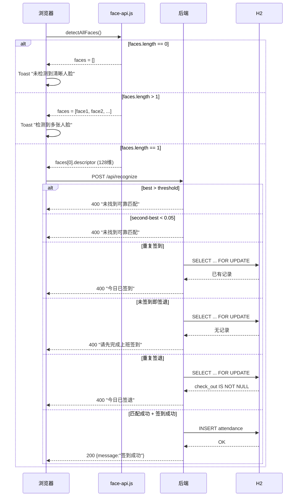
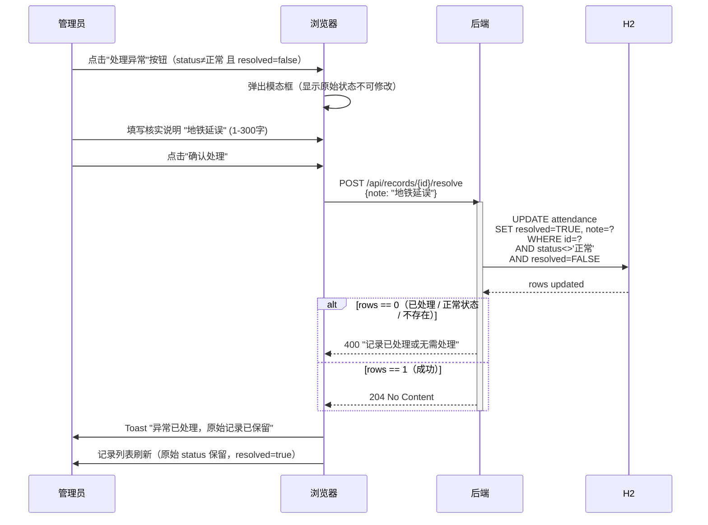
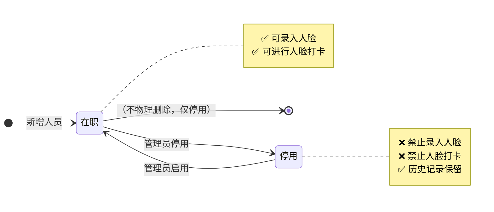
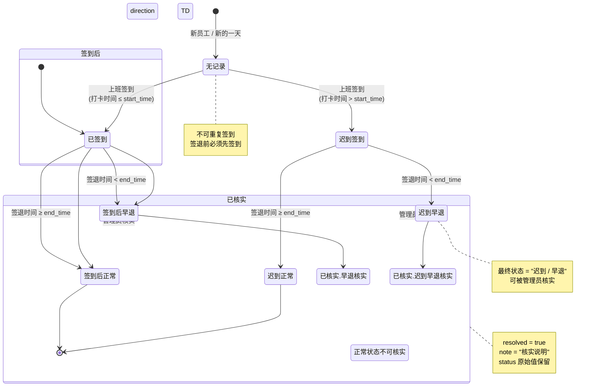
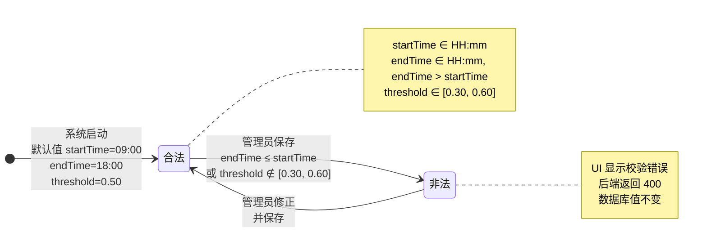
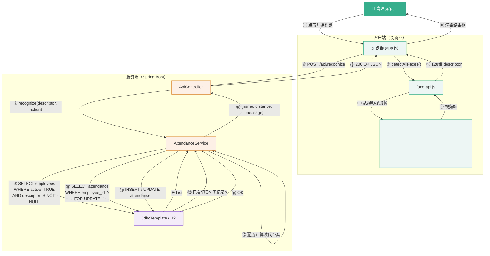

# 第三步 · 行为建模（Behavioral Modeling）

> **面向对象分析（OOA）第三步**：在已识别的类和关系基础上，用动态图展示类之间的交互时序、对象的状态变迁、以及消息传递路径。
> 方法：时序图 → 状态图 → 协作图
> 生成日期：2026-11-03

---

## 1. 行为建模方法说明

| UML 图 | 回答的问题 | 本项目价值 |
|--------|-----------|-----------|
| **时序图** (Sequence Diagram) | "谁先做什么，再通知谁？" | 人脸打卡的请求-响应完整链路 |
| **状态图** (State Diagram) | "一个对象有哪些状态，怎么变迁？" | AttendanceRecord 的签到/签退状态机 |
| **协作图** (Collaboration Diagram) | "谁和谁直接通信？" | 识别过程中服务层与各业务类的消息路径 |

---

## 2. 时序图（Sequence Diagram）

> Mermaid 语法：`sequenceDiagram`，participant 定义参与者，`->>` 实线请求，`-->>` 虚线回复，`activate/deactivate` 表示激活期。

### 2.1 时序图 A：人脸录入完整链路

> 展示从管理员点击"录入人脸"到数据库保存的完整消息流。

```mermaid
sequenceDiagram
    participant Admin as 系统管理员
    participant Browser as 浏览器<br>(app.js)
    participant FaceAPI as face-api.js
    participant Server as 后端<br>(AttendanceService)
    participant DB as H2 数据库

    Admin->>Browser: 点击"录入人脸"按钮
    Browser->>Browser: 打开打卡页<br>currentEnroll = employeeId
    Admin->>Browser: 点击"开启摄像头"

    rect rgb(237, 246, 244)
        Note over Browser,FaceAPI: 模型加载（客户端）
        Browser->>FaceAPI: loadFromUri('/models')<br>TinyFaceDetector+Landmark68+RecognitionNet
        FaceAPI-->>Browser: 模型就绪
    end

    Admin->>Browser: 点击"采集并保存"

    rect rgb(253, 240, 230)
        Note over Browser,FaceAPI: 特征提取（客户端）
        Browser->>FaceAPI: detectAllFaces(video)<br>.withFaceLandmarks()<br>.withFaceDescriptors()
        FaceAPI-->>Browser: faces[0].descriptor<br>(128维 double[])
    end

    Browser->>Server: POST /api/employees/{id}/face<br>{descriptor: [...]}
    activate Server

    rect rgb(244, 236, 249)
        Note over Server,DB: 后端校验与重复检查
        Server->>Server: vector(descriptor)<br>校验128维/值域/归一化
        Server->>DB: SELECT id, descriptor<br>FROM employees<br>WHERE descriptor IS NOT NULL
        DB-->>Server: List<Employee>
        loop 遍历每个已录人脸
            Server->>Server: distance(newDescriptor, existing.descriptor)<br>欧氏距离计算
            alt 欧氏距离 < 0.5
                Server-->>Browser: 400 Bad Request<br>"此人脸已被其他人员录入"
                deactivate Server
                Admin->>Browser: Toast 错误提示
            end
        end
    end

    Server->>DB: UPDATE employees<br>SET descriptor = ?<br>WHERE id = ? AND active = TRUE
    DB-->>Server: update count
    Server-->>Browser: 204 No Content
    deactivate Server

    Browser->>Admin: Toast "人脸档案已保存"
    Browser->>Browser: 跳转回人员管理页
```

**时序图解读**：
- 客户端（浏览器）承担模型加载和特征提取（face-api.js）
- 后端做 3 层校验：描述符合法性 → 欧氏距离重复检查 → 人员存在性
- 重复检查是 O(N) 遍历，N = 已录人脸数（数百人规模可接受）

---

### 2.2 时序图 B：人脸打卡（上班签到·正常流程）

> 最核心的业务场景，展示识别 → 匹配 → 签到的完整链路。

```mermaid
sequenceDiagram
    participant Emp as 员工
    participant Browser as 浏览器<br>(app.js)
    participant FaceAPI as face-api.js
    participant Server as 后端<br>(AttendanceService)
    participant DB as H2 数据库

    Emp->>Browser: 走到摄像头前（画面单张脸）
    Emp->>Browser: 点击"开始识别"

    rect rgb(237, 246, 244)
        Browser->>FaceAPI: detectAllFaces().withLandmarks().withDescriptors()
        FaceAPI-->>Browser: faces[0].descriptor
    end

    Browser->>Server: POST /api/recognize<br>{descriptor: [...], action: "in"}
    activate Server

    rect rgb(253, 240, 230)
        Note over Server,DB: Step 1 - 匹配所有在职人员
        Server->>Server: vector(descriptor)<br>校验 128 维
        Server->>DB: SELECT id, name, descriptor<br>FROM employees<br>WHERE active = TRUE<br>AND descriptor IS NOT NULL
        DB-->>Server: List<Employee>
        loop 遍历每个 Employee
            Server->>Server: distance(input, emp.descriptor)
            alt d < best
                Server->>Server: second = best<br>best = d<br>match = emp
            else d < second
                Server->>Server: second = d
            end
        end
    end

    rect rgb(244, 236, 249)
        Note over Server,Server: Step 2 - 三重校验
        alt match == null OR best > threshold
            Server-->>Browser: 400 "未找到可靠匹配"
            deactivate Server
        else second - best < 0.05
            Server-->>Browser: 400 "未找到可靠匹配"
            deactivate Server
        end
    end

    rect rgb(232, 246, 237)
        Note over Server,DB: Step 3 - 签到事务
        Server->>DB: SELECT * FROM attendance<br>WHERE employee_id=? AND attendance_date=?<br>FOR UPDATE（行锁）
        DB-->>Server: 已有记录?

        alt 已有记录（重复签到）
            Server-->>Browser: 400 "今日已签到"
            deactivate Server
        else 无记录 → 正常签到
            Server->>Server: now = LocalDateTime.now()<br>status = now > start_time ? "迟到" : "正常"
            Server->>DB: INSERT INTO attendance<br>(employee_id, attendance_date,<br>check_in, status, source, distance)
            DB-->>Server: INSERT OK
        end
    end

    Server-->>Browser: 200 OK<br>{name, distance, message, time}
    deactivate Server
    Browser->>Emp: 显示 "李晴，签到成功 · 匹配距离 0.382 · 09:05"
```

---

### 2.3 时序图 C：人脸打卡（拒绝分支汇总）

> 展示所有可能拒绝打卡的分支路径，用 alt 块集中表达。



---

### 2.4 时序图 D：异常核实

> 单一交互，流程较简单但必须**不改变原始状态**。



---

## 3. 状态图（State Diagram）

> Mermaid 语法：`stateDiagram-v2`，`[*]` 表示初始/终止状态，`State1 --> State2 : 事件/触发` 表示变迁。

### 3.1 状态图 A：Employee 状态

> Employee 有两个独立的状态维度：在职状态 + 人脸录入状态。



### 3.2 状态图 B：AttendanceRecord 状态（核心）

> AttendanceRecord 的状态变迁是系统最复杂的行为，有清晰的状态机：



#### AttendanceRecord 状态变迁规则表

| 当前状态 | 触发事件 | 条件 | 目标状态 | 代码位置 |
|----------|----------|------|----------|----------|
| 无记录 | 上班签到 | 时间 ≤ start_time | 已签到 | `recognize("in")` → `status="正常"` |
| 无记录 | 上班签到 | 时间 > start_time | 迟到签到 | `recognize("in")` → `status="迟到"` |
| 已签到 | 下班签退 | 时间 ≥ end_time | 签到后正常 | `recognize("out")` → status 保留 |
| 已签到 | 下班签退 | 时间 < end_time | 签到后早退 | `recognize("out")` → `status="早退"` |
| 迟到签到 | 下班签退 | 时间 ≥ end_time | 迟到正常 | `recognize("out")` → status 保留 "迟到" |
| 迟到签到 | 下班签退 | 时间 < end_time | 迟到早退 | `recognize("out")` → `status="迟到 / 早退"` |
| 签到后早退 | 管理员核实 | note ∈ [1,300]字 | 已核实.早退核实 | `resolve()` → `resolved=true` |
| 迟到早退 | 管理员核实 | note ∈ [1,300]字 | 已核实.迟到早退核实 | `resolve()` → `resolved=true` |
| 任何已核实状态 | 再次核实 | — | **拒绝** | `WHERE resolved=FALSE` |

---

### 3.3 状态图 C：AttendanceSettings 状态

> 配置类，状态较简单，但有合法性校验状态。



---

## 4. 协作图（Collaboration Diagram）

> Mermaid 中用 `graph TD` 模拟 UML Collaboration Diagram，展示对象之间直接的消息路径。

### 4.1 协作图 A：人脸打卡识别协作

> 展示一次完整打卡中，谁与谁直接通信、通信方向和消息编号。



### 4.2 消息路径汇总表

| 编号 | 发送者 | 接收者 | 消息类型 | 消息内容 |
|------|--------|--------|----------|----------|
| ① | Actor | Browser | 用户事件 | 点击"开始识别" |
| ② | Browser | FaceAPI | API 调用 | `detectAllFaces().withLandmarks().withDescriptors()` |
| ③ | FaceAPI | Video | DOM 读取 | 获取当前视频帧 |
| ④ | Video | FaceAPI | 返回 | ImageData 帧 |
| ⑤ | FaceAPI | Browser | 返回 | `Float32Array[128]` descriptor |
| ⑥ | Browser | Controller | HTTP POST | `/api/recognize {descriptor, action}` |
| ⑦ | Controller | Service | 方法调用 | `recognize(List<Double>, String)` |
| ⑧ | Service | DB | SQL | 查所有在职已录脸的员工 |
| ⑨ | DB | Service | 结果集 | `List<Map<String,Object>>` |
| ⑩ | Service | Service | 内部循环 | 欧氏距离计算 + best/second 记录 |
| ⑪ | Service | DB | SQL + 行锁 | 查当日该员工考勤记录 |
| ⑫ | DB | Service | 结果集 | 已有记录 / 无记录 |
| ⑬ | Service | DB | SQL | INSERT / UPDATE |
| ⑭ | DB | Service | 影响行数 | update count |
| ⑮ | Service | Controller | 返回值 | `Map.of("name",..., "distance",...)` |
| ⑯ | Controller | Browser | HTTP 200 | JSON Response |
| ⑰ | Browser | Actor | UI 渲染 | 结果框展示 |

---

## 5. 行为建模输出总结

```
┌────────────────────────────────────────────────────────────┐
│                OOA 第三步 · 行为建模输出                      │
│                                                            │
│  ✅ 4 张时序图：                                             │
│     A. 人脸录入完整链路（客户端+后端协作）                    │
│     B. 人脸打卡·正常签到（三重校验 + 事务）                  │
│     C. 人脸打卡·拒绝分支汇总（7 种拒绝场景）                  │
│     D. 异常核实（单向更新，保留原始状态）                     │
│                                                            │
│  ✅ 3 张状态图：                                             │
│     A. Employee：在职 ↔ 停用（2 态双维度）                    │
│     B. AttendanceRecord：无记录 → 签到 → 签退 → 核实          │
│        （最复杂的状态机，6 个状态 + 8 条变迁规则）            │
│     C. AttendanceSettings：合法 ↔ 非法（配置校验）            │
│                                                            │
│  ✅ 1 张协作图：                                             │
│     人脸打卡完整消息路径（客户端→服务端→DB 共 17 步）         │
│     + 消息路径汇总表                                         │
│                                                            │
│  行为模式识别：                                              │
│  ┌────────────────────────────────────────────────────┐    │
│  │ 识别 → 匹配 → 校验 → 事务写入                        │    │
│  │   ↑                                    ↑             │    │
│  │   └── 客户端特征提取                    └── FOR UPDATE│    │
│  │        (face-api.js)                        行锁      │    │
│  └────────────────────────────────────────────────────┘    │
│                                                            │
│  关键行为边界：                                              │
│  • 客户端承担所有视觉计算（摄像头采集 + 特征提取）            │
│  • 后端承担所有业务校验（距离匹配 + 重复检查 + 事务保护）     │
│  • 三重校验形成"安全网"：阈值 + 次佳差距 + 唯一性约束         │
│  • 原始状态不可变：核实只加备注，不改 status                 │
└────────────────────────────────────────────────────────────┘
```

---

## 6. 面向对象分析建模 · 完成总结

### 三步建模产出清单

| 步骤 | 文档 | 核心产出 |
|------|------|----------|
| **第一步 · 场景建模** | [01-场景建模.md](./01-场景建模.md) | 5 个业务场景、9 个用例、3 张活动图、对象识别 → 3 类 |
| **第二步 · 静态建模** | [02-静态建模.md](./02-静态建模.md) | 完整类图（3 类 20+ 属性）、CRC 卡片 × 3、关系确认 |
| **第三步 · 行为建模** | [03-行为建模.md](./03-行为建模.md) | 4 张时序图、3 张状态图、1 张协作图 |

### 建模质量评估

| 评估维度 | 结论 | 说明 |
|----------|------|------|
| **完整性** | ✅ 高 | 覆盖场景/静态/行为三个建模维度 |
| **一致性** | ✅ 高 | 类图 ↔ 数据库表 ↔ 代码实现 对齐 |
| **可追溯性** | ✅ 高 | 每个类/方法/状态变迁都有 Story 和用例来源 |
| **复杂度控制** | ✅ 好 | 3 个业务类规模适中，最高复杂度类 AttendanceRecord 有 6 状态 |
| **边界明确** | ✅ 好 | 客户端 vs 服务端职责清晰；外部组件（face-api.js）作为参与者 |

### 下一步：进入迭代设计（OOD）

SPEC 编程方法在 OOA 建模完成后，进入迭代 1 的**测试用例**编写和**详细设计**阶段。OOA 的 3 个业务类将转化为设计层的 4 个 Spring 组件：

```
OOA 业务类          →  OOD 实现组件
──────────────────────────────────
Employee            →  JdbcTemplate RowMapper + 表
AttendanceRecord    →  JdbcTemplate RowMapper + 表
AttendanceSettings  →  JdbcTemplate RowMapper + 表
（服务协调者）        →  AttendanceService.java （设计层的 Facade）
（API 层）           →  ApiController.java      （HTTP 适配）
（安全层）           →  SecurityConfig.java     （Spring Security）
```

---

**文档版本**：v1.0
**生成日期**：2026-11-03
**所属阶段**：OOA 第三步 · 行为建模
