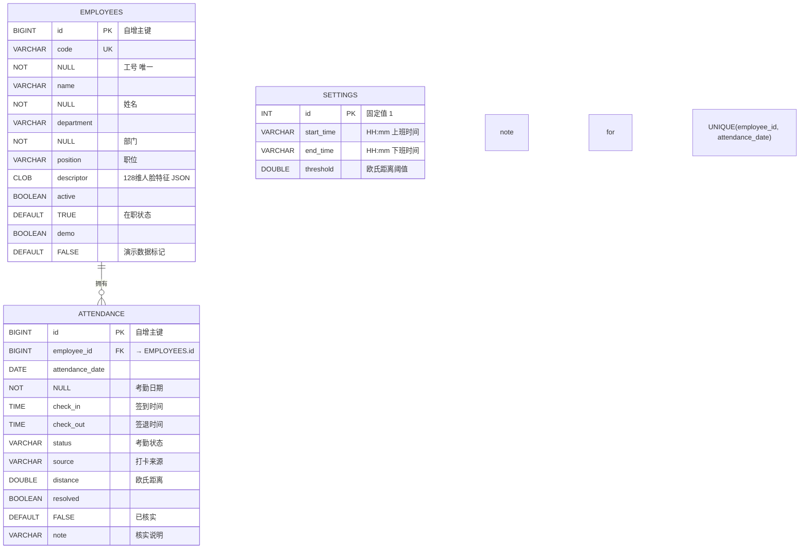

# 软件需求规格说明书（SRS）

## 知勤 · 人脸识别考勤管理系统

---

**文档编号**：SRS-Qin-2026-001
**文档版本**：v1.0
**编制单位**：软件工程课程设计 · 开发团队
**编制日期**：2026-11-03
**状态**：评审通过

---

## 修订历史

| 版本 | 日期 | 修订内容 | 修订人 |
|------|------|----------|--------|
| v1.0 | 2026-11-03 | 初稿，基于需求分析和 OOA 建模产出整合 | 开发团队 |

---

## 目录

1. [引言](#1-引言)
2. [总体描述](#2-总体描述)
3. [功能需求](#3-功能需求)
4. [非功能需求](#4-非功能需求)
5. [外部接口需求](#5-外部接口需求)
6. [数据需求](#6-数据需求)
7. [验收标准](#7-验收标准)
8. [附录](#8-附录)

---

## 1. 引言

### 1.1 编写目的

本软件需求规格说明书（Software Requirements Specification, SRS）是"知勤 · 人脸识别考勤管理系统"的正式需求基线文档。本文档的目标是：

- 明确系统的功能需求和非功能需求，作为开发、测试、评审的唯一依据
- 为课程设计答辩提供完整的需求规格可追溯证据
- 定义迭代 1（MVP）的交付范围和验收标准

本文档面向以下读者：

| 读者 | 使用方式 |
|------|----------|
| 开发人员 | 作为编码实现的需求基线 |
| 测试人员 | 编写测试用例的依据（第 3、4、7 章） |
| 课程导师 / 评审者 | 评审需求完整性、正确性、可追溯性 |
| 项目组 | 迭代规划、范围控制 |

### 1.2 项目范围

**产品名称**：知勤 · 人脸识别考勤管理系统

**产品定位**：面向小型团队的轻量级人脸识别考勤解决方案，全本地化部署，纯浏览器运行，无需专用考勤硬件。

**目标用户**：系统管理员（HR / 行政人员）

**迭代规划**：

| 迭代 | 版本 | 目标 | 核心产出 |
|------|------|------|----------|
| 迭代 1 | V1.0 | 核心闭环（MVP） | 登录 → 建人 → 录脸 → 打卡 → 记录 → 导出 全链路可演示 |
| 迭代 2 | V1.1 | 体验增强 | 考勤趋势图、环形分布图、部门分析、状态筛选 |
| 迭代 3 | V1.2 | 运维增强 | 人脸重新录入、密码修改、数据备份 |

本文档仅覆盖**迭代 1（V1.0）**的完整需求规格。后续迭代需求记录在附录 B。

### 1.3 术语与缩略语

| 术语 / 缩略语 | 定义 |
|---------------|------|
| **SRS** | Software Requirements Specification，软件需求规格说明书 |
| **OOA** | Object-Oriented Analysis，面向对象分析 |
| **SPEC** | Specification-based Programming，基于规格的编程方法 |
| **MVP** | Minimum Viable Product，最小可行产品 |
| **Descriptor** | 人脸特征描述符，本系统特指 128 维浮点向量 |
| **Euclidean Distance** | 欧氏距离，两个 Descriptor 的几何距离，衡量人脸相似度 |
| **MUST / SHOULD / COULD / WON'T** | MoSCoW 优先级分类，见 3.1 节 |
| **CSRF** | Cross-Site Request Forgery，跨站请求伪造 |
| **BCrypt** | 自适应哈希算法，Spring Security 推荐密码编码方式 |
| **H2** | 嵌入式 Java 数据库，支持文件模式持久化 |
| **face-api.js** | 基于 TensorFlow.js 的浏览器端人脸识别库（v1.7.15） |
| **TinyFaceDetector** | face-api.js 提供的轻量级人脸检测器 |
| **Landmark68Net** | face-api.js 提供的 68 点人脸关键点定位网络 |
| **FaceRecognitionNet** | face-api.js 提供的 128 维特征编码网络 |
| **ISO** | ISO/IEC/IEEE 29148，国际需求工程标准 |
| **CRC** | Class-Responsibility-Collaboration，类-职责-协作者卡片方法 |

### 1.4 参考资料

| 编号 | 资料名称 | 说明 |
|------|----------|------|
| R-01 | IEEE 830-1998 / ISO/IEC/IEEE 29148 | SRS 编写标准 |
| R-02 | OOA 建模文档 | [docs/modeling/](./modeling/) 三步建模产出 |
| R-03 | 需求分析文档 | [docs/requirements/](./requirements/) 七份文档 |
| R-04 | 源代码 | `src/main/java/com/attendance/` |
| R-05 | face-api.js v1.7.15 | [GitHub 仓库](https://github.com/vladmandic/face-api) |
| R-06 | Spring Boot 3.5.7 官方文档 | 框架参考 |
| R-07 | 软件工程课程教学大纲 | 能力点要求 |

---

## 2. 总体描述

### 2.1 产品视角（Product Perspective）

本产品是一个**独立系统**，不与其他外部业务系统集成。系统边界如下：

```
┌─────────────────────────────────────────────────────────────────┐
│                                                                 │
│                    知勤考勤管理系统                                │
│                                                                 │
│  ┌─────────────────────────────────────────────────────────────┐│
│  │                                                             ││
│  │  子系统 A: 前端（浏览器）          子系统 B: 后端（Spring Boot）││
│  │  ┌──────────────────────┐          ┌──────────────────────┐ ││
│  │  │ face-api.js 模型加载  │          │ Spring Security     │ ││
│  │  │ TinyFaceDetector     │          │   ├─ 表单登录       │ ││
│  │  │ Landmark68Net        │          │   ├─ Session        │ ││
│  │  │ FaceRecognitionNet   │          │   └─ CSRF            │ ││
│  │  │ 摄像头帧采集          │          │                      │ ││
│  │  │ 128维描述符提取      │          │ AttendanceService    │ ││
│  │  └──────────┬──────────┘          │   ├─ 人员管理       │ ││
│  │             │ POST JSON             │   ├─ 人脸录入       │ ││
│  │             ▼                       │   ├─ 人脸打卡       │ ││
│  │  ┌──────────────────────┐          │   ├─ 记录查询       │ ││
│  │  │  同源 REST API        │◄────────►│   ├─ 异常核实       │ ││
│  │  └──────────────────────┘          │   ├─ 规则配置       │ ││
│  │                                     │   └─ CSV 导出       │ ││
│  │                                     └──────────┬──────────┘ ││
│  │                                                │ JDBC        ││
│  └────────────────────────────────────────────────┼──────────────┘│
│                                                   │              │
│                                                   ▼              │
│                                     ┌──────────────────────┐     │
│                                     │  H2 嵌入式数据库      │     │
│                                     │  (文件: attendance.mv.db)│  │
│                                     └──────────────────────┘     │
│                                                                 │
│  ┌────────────────────────────────────────────────────────────┐ │
│  │  外部组件（不属于本系统）                                     │ │
│  │  · 浏览器（Chrome / Edge 最新版）                             │ │
│  │  · 摄像头硬件（720p+，光线充足）                              │ │
│  │  · face-api.js v1.7.15 （MIT License）                        │ │
│  └────────────────────────────────────────────────────────────┘ │
└─────────────────────────────────────────────────────────────────┘
```

**系统与外部的接口**：

| 接口方向 | 接口对象 | 接口内容 |
|----------|----------|----------|
| 系统 ← | 浏览器 | 摄像头视频流（`getUserMedia`） |
| 系统 → | H2 数据库 | JDBC SQL（读写 employees / attendance / settings） |
| 系统 → | 浏览器 HTTP 响应 | HTML 页面 / JSON API / CSV 文件 |

### 2.2 功能概览（Function Summary）

迭代 1（V1.0）包含 7 大功能模块：

| 编号 | 功能模块 | 核心能力 | 对应 OOA 用例 |
|------|----------|----------|--------------|
| F-01 | 登录认证 | 表单登录、BCrypt 密码、CSRF 保护、Session 管理 | UC-01 |
| F-02 | 人员管理 | 新增（工号唯一）、停用/启用、列表查询 | UC-02 |
| F-03 | 人脸录入 | 摄像头采集、128 维描述符提取、欧氏距离重复检查 | UC-03 |
| F-04 | 人脸打卡 | 签到/签退、距离匹配、三重校验、拒绝分支 | UC-04 |
| F-05 | 考勤数据 | 考勤总览（4 项统计）、记录查询（日期+筛选）、异常核实 | UC-05/06/07 |
| F-06 | 规则配置 | 上/下班时间、识别阈值（0.30-0.60） | UC-09 |
| F-07 | CSV 导出 | UTF-8 BOM + 公式注入防护、完整记录 | UC-08 |

### 2.3 用户特征（User Characteristics）

| 维度 | 描述 |
|------|------|
| 角色 | 系统管理员（HR 或行政人员） |
| 技术水平 | 一般，能使用浏览器进行日常办公 |
| 主要任务 | 人员建档、每日考勤巡检、异常核实、月末报表导出、规则调整 |
| 使用频率 | 高频（至少每日一次打卡巡检） |
| 安全需求 | 系统仅监听 localhost，管理员凭证由环境变量配置 |
| 对系统的期待 | "简单、可靠、不用培训就能上手" |

**明确不支持的用户类型**：

- ❌ 企业员工（被考勤对象，无自助访问入口）
- ❌ 多管理员角色分权（当前仅单管理员）
- ❌ 移动端用户（纯浏览器 Web 应用）

### 2.4 运行环境（Operating Environment）

| 类别 | 要求 |
|------|------|
| **操作系统** | Windows 10/11、macOS 12+、Linux（x86_64） |
| **Java 运行时** | OpenJDK 17 或更高 |
| **浏览器** | Chrome / Edge 最新版（需支持 `getUserMedia` API） |
| **摄像头** | 720p 及以上，固定焦距，光线充足（> 200 lux） |
| **网络** | localhost 直接可用；公网访问摄像头需 HTTPS |
| **磁盘** | ≥ 50MB（含模型文件 + 数据库） |
| **端口** | 默认 8080，可通过 `PORT` 环境变量配置 |

### 2.5 设计约束（Design Constraints）

| 编号 | 约束 | 来源 |
|------|------|------|
| DC-01 | 后端必须使用 Java 17 + Spring Boot 3.5.7 | 技术选型决策 |
| DC-02 | 前端必须使用原生 HTML/CSS/JS，不得引入 React/Vue 等框架 | 项目规模约束 |
| DC-03 | 人脸识别库锁定 face-api.js v1.7.15 | 模型文件已固定 |
| DC-04 | 数据库锁定 H2 文件模式，不得切换 PostgreSQL/MySQL | 单机部署场景 |
| DC-05 | 管理员账号密码通过环境变量配置，不存入数据库 | 安全设计决策 |
| DC-06 | 所有时间按 Asia/Shanghai（UTC+8）时区处理 | 业务地理边界 |
| DC-07 | 课程周期内完成迭代 1，优先保证功能闭环 | 时间约束 |

### 2.6 假设与依赖（Assumptions & Dependencies）

| 编号 | 类型 | 描述 | 验证方法 |
|------|------|------|----------|
| A-01 | 假设 | 管理员具备基础浏览器操作能力 | 产品目标用户画像 |
| A-02 | 假设 | 摄像头硬件正常、光线充足、对焦准确 | 打卡界面提示 |
| A-03 | 假设 | 管理员已取得员工知情同意后才采集人脸 | 录入页面声明 |
| A-04 | 假设 | 打卡场景受监督（有人值守），无伪造风险 | 产品边界声明 |
| A-05 | 假设 | 单机部署，在职人数 ≤ 500 人，年考勤记录 ≤ 500×2×365 ≈ 36 万 | 性能测试 |
| D-01 | 依赖 | JDK 17 已安装，`JAVA_HOME` 已配置 | `scripts/start.ps1` 检查 |
| D-02 | 依赖 | Maven 3.6.3+ 可用 | 同上 |
| D-03 | 依赖 | 首次运行前执行 `scripts/download-models.ps1` 下载模型 | README 说明 |
| D-04 | 依赖 | Chrome/Edge 支持 `navigator.mediaDevices.getUserMedia` | 浏览器版本检查 |

### 2.7 明确不做的（Out of Scope）

> 以下功能明确**不在迭代 1 范围内**，后续迭代优先级见附录 B。

| 编号 | 功能 | 不做理由 |
|------|------|----------|
| N-01 | ❌ 活体检测 | 技术复杂度高，边界声明"仅用于受监督演示" |
| N-02 | ❌ 服务端人脸特征提取 | face-api.js 纯前端库 |
| N-03 | ❌ 排班管理 | 超出课程范围 |
| N-04 | ❌ 请假 / 加班 / 节假日管理 | 超出课程范围 |
| N-05 | ❌ 员工自助账号 / 角色分权 | 无 RBAC 体系支撑 |
| N-06 | ❌ 移动端 App | 聚焦 Web 技术栈 |
| N-07 | ❌ 云端部署 / 多租户 | 单机部署场景 |
| N-08 | ❌ 人脸特征加密存储 | 课程范围，当前仅文件权限控制 |

---

## 3. 功能需求

### 3.1 优先级说明

所有功能需求按 MoSCoW 法则分类：

| 优先级 | 含义 | 迭代 1 必须交付 |
|--------|------|------------------|
| **MUST** | 必须有，缺失则无法交付核心闭环 | ✅ |
| **SHOULD** | 应该有，缺失则产品质量下降但可交付 | ⚠️ 部分延期至迭代 2 |
| **COULD** | 可以有，锦上添花 | ❌ 延期至迭代 3+ |
| **WON'T** | 不做（见 2.7 节） | ❌ |

---

### 3.2 功能需求 F-01：登录认证

| 需求编号 | 需求名称 | 优先级 | 原始来源 |
|----------|----------|--------|----------|
| FR-01 | 管理员通过账号密码登录系统 | MUST | ST-01 |
| FR-02 | 密码 BCrypt 编码存储 | MUST | ST-01 |
| FR-03 | Session 60 分钟无操作自动失效 | MUST | ST-05 |
| FR-04 | API 未登录返回 401 JSON | MUST | ST-03 |
| FR-05 | 所有 POST/PATCH 请求启用 CSRF 保护 | MUST | ST-02 |
| FR-06 | 支持退出登录 | MUST | ST-04 |

**FR-01 详细描述**：

| 项目 | 内容 |
|------|------|
| 需求 | 系统必须提供表单登录页面 `/login.html`，管理员输入用户名和密码后提交，Spring Security 校验凭证。 |
| 输入 | `username`（String, 必须）、`password`（String, 必须） |
| 前置条件 | Session 不存在或已过期 |
| 后置条件 | Session 创建，管理员被重定向到 `/`（工作台首页） |
| 异常处理 | 密码错误 → 重定向 `/login.html?error=1`，页面显示错误提示 |
| 业务规则 | 管理员凭证通过环境变量 `ADMIN_USERNAME`（默认 `admin`）和 `ADMIN_PASSWORD`（默认 `Admin@2026`）配置，不在数据库中存储 |

---

### 3.3 功能需求 F-02：人员管理

| 需求编号 | 需求名称 | 优先级 | 原始来源 |
|----------|----------|--------|----------|
| FR-07 | 新增人员（工号唯一约束） | MUST | ST-06, ST-07 |
| FR-08 | 人员列表查询（含在职状态 + 人脸录入状态） | MUST | ST-08 |
| FR-09 | 人员启用 / 停用 | MUST | ST-09 |
| FR-10 | 停用人员禁止人脸打卡和录入 | MUST | ST-10 |

**FR-07 详细描述**：

| 项目 | 内容 |
|------|------|
| 需求 | 系统允许管理员新增团队成员，工号必须全局唯一。 |
| 输入 | `code`（String ≤ 30）、`name`（String ≤ 50）、`department`（String ≤ 50）、`position`（String ≤ 80） |
| 接口 | `POST /api/employees`，Content-Type: `application/json` |
| 前置条件 | 已登录（Session 有效） |
| 后置条件 | `employees` 表 INSERT 一条记录，`active=TRUE`，`demo=FALSE` |
| 异常处理 | 字段为空 / 超长 → 400 + 具体字段提示；工号重复 → 400 + "工号已存在或数据不符合要求" |
| 业务规则 | 工号、姓名、部门为必填；职位可选但非空时校验长度 |

---

### 3.4 功能需求 F-03：人脸录入

| 需求编号 | 需求名称 | 优先级 | 原始来源 |
|----------|----------|--------|----------|
| FR-11 | 打开摄像头并请求权限 | MUST | ST-11 |
| FR-12 | 本地提取 128 维人脸描述符 | MUST | ST-11 |
| FR-13 | 校验描述符合法性 | MUST | ST-12 |
| FR-14 | 与已录入人脸做欧氏距离重复检查（阈值 0.50） | MUST | ST-13 |
| FR-15 | 停用人员禁止录入人脸 | MUST | ST-14 |

**FR-12 详细描述**：

| 项目 | 内容 |
|------|------|
| 需求 | 浏览器端使用 face-api.js 加载 TinyFaceDetector + Landmark68Net + FaceRecognitionNet 三个模型，从摄像头视频帧中提取单张人脸的 128 维 Float32Array 描述符。 |
| 输入 | 摄像头视频流（640×480，facingMode: user） |
| 输出 | `double[128]`，序列化后 JSON 数组 |
| 前置条件 | 浏览器已授权摄像头权限；目标人员存在且在职；管理员已取得员工知情同意 |
| 业务规则 | 画面中必须且仅能有一张清晰人脸（`faces.length === 1`），否则拒绝采集 |

**FR-14 详细描述**：

| 项目 | 内容 |
|------|------|
| 需求 | 后端在保存新 descriptor 前，必须遍历 `descriptor IS NOT NULL` 的所有在职人员，逐一计算欧氏距离 `d = √(Σᵢ₌₀¹²⁷ (aᵢ - bᵢ)²)`，若任何一对距离 < 0.50，则拒绝保存。 |
| 输入 | 待保存的 `double[128]` |
| 输出 | 欧氏距离计算结果 |
| 阈值 | 固定 0.50（硬编码，与打卡识别默认阈值一致） |
| 异常处理 | 距离 < 0.50 → 400 + "此人脸已被其他人员录入" |

---

### 3.5 功能需求 F-04：人脸打卡（核心）

| 需求编号 | 需求名称 | 优先级 | 原始来源 |
|----------|----------|--------|----------|
| FR-16 | 识别匹配（遍历所有在职已录脸人员的欧氏距离） | MUST | ST-15 |
| FR-17 | 匹配距离超阈值时拒绝（默认 0.50，可配置 0.30–0.60） | MUST | ST-17 |
| FR-18 | 次佳匹配与最优差距 < 0.05 时拒绝（模糊匹配保护） | MUST | ST-18 |
| FR-19 | 今日已签到不可重复签到 | MUST | ST-20 |
| FR-20 | 签退前必须完成签到 | MUST | ST-21 |
| FR-21 | 今日已签退不可重复签退 | MUST | ST-22 |
| FR-22 | 迟到自动判断（时间 > start_time） | MUST | ST-23 |
| FR-23 | 早退自动判断（时间 < end_time） | MUST | ST-23 |
| FR-24 | 多人脸 / 无人脸时拒绝 | MUST | ST-24 |

**FR-16 / FR-17 / FR-18 三重校验详细描述**：

```
识别请求 → 遍历所有 active=TRUE AND descriptor IS NOT NULL 的 Employee
    ↓
    计算欧氏距离 → 找出 best（最小距离）和 second（次小距离）
    ↓
    ┌─ match == null → 拒绝 "未找到可靠匹配"
    ├─ best > threshold → 拒绝 "未找到可靠匹配"
    ├─ second - best < 0.05 → 拒绝 "未找到可靠匹配"（模糊保护）
    └─ 全部通过 → 匹配成功
```

**FR-19 / FR-20 / FR-21 签到签退互斥规则**：

| 打卡动作 | 前置检查 | 拒绝条件 |
|----------|----------|----------|
| 上班签到 (`action="in"`) | 查询 `attendance WHERE employee_id=? AND attendance_date=? FOR UPDATE` | 已有记录 → "今日已签到" |
| 下班签退 (`action="out"`) | 同上 | 记录不存在 → "请先完成上班签到"；`check_out IS NOT NULL` → "今日已签退" |

**FR-22 / FR-23 状态判断规则**：

| 打卡动作 | 当前状态 | 时间条件 | 新状态 |
|----------|----------|----------|--------|
| 签到 | 无记录 | `now > start_time` | `"迟到"` |
| 签到 | 无记录 | `now ≤ start_time` | `"正常"` |
| 签退 | `"正常"` | `now < end_time` | `"早退"` |
| 签退 | `"正常"` | `now ≥ end_time` | `"正常"`（不变） |
| 签退 | `"迟到"` | `now < end_time` | `"迟到 / 早退"` |
| 签退 | `"迟到"` | `now ≥ end_time` | `"迟到"`（不变） |

**接口定义**：

| 项目 | 内容 |
|------|------|
| URL | `POST /api/recognize` |
| Content-Type | `application/json` |
| 请求体 | `{"descriptor": [0.12, -0.34, ..., 0.56], "action": "in" \| "out"}` |
| 成功响应 | `200 OK` + `{"name":"李晴","distance":0.382,"message":"签到成功","time":"09:05"}` |
| 失败响应 | `400 Bad Request` + `{"message":"具体原因"}` |

---

### 3.6 功能需求 F-05：考勤数据管理

| 需求编号 | 需求名称 | 优先级 | 原始来源 |
|----------|----------|--------|----------|
| FR-25 | 今日应到人数统计（在职人员数） | MUST | ST-25 |
| FR-26 | 今日实际出勤人数（有签到记录） | MUST | ST-25 |
| FR-27 | 今日考勤异常人数（状态 ≠ "正常"） | MUST | ST-25 |
| FR-28 | 今日尚未签到人数（应到 − 出勤） | MUST | ST-25 |
| FR-29 | 日期范围查询（最长 1 年） | MUST | ST-26 |
| FR-30 | 姓名 / 工号 / 部门搜索筛选 | MUST | ST-27 |
| FR-31 | 异常考勤核实（添加 1–300 字说明，`resolved=TRUE`） | MUST | ST-28 |
| FR-32 | 核实不改变原始状态 | MUST | ST-29 |
| FR-33 | 已核实记录不可重复处理 | MUST | ST-30 |

**FR-31 / FR-32 / FR-33 异常核实详细描述**：

| 项目 | 内容 |
|------|------|
| 接口 | `POST /api/records/{id}/resolve` |
| 请求体 | `{"note": "已核实，地铁延误"}` |
| 业务规则 | SQL: `UPDATE attendance SET resolved=TRUE, note=? WHERE id=? AND status<>'正常' AND resolved=FALSE` |
| 影响行数 | 预期 `affected = 1`；若 = 0 → 返回 400 "记录已处理或无需处理" |
| 不可变约束 | `status` 字段**在任何核实操作中不可修改**，仅写 `note` 字段和 `resolved` 标志 |

---

### 3.7 功能需求 F-06：规则配置

| 需求编号 | 需求名称 | 优先级 | 原始来源 |
|----------|----------|--------|----------|
| FR-34 | 上/下班时间可配置（格式 HH:mm） | MUST | ST-31 |
| FR-35 | 下班时间必须晚于上班时间 | MUST | ST-32 |
| FR-36 | 识别阈值可配置（范围 0.30 – 0.60） | MUST | ST-33 |
| FR-37 | 设置变更仅影响后续打卡（历史记录状态保留） | MUST | 业务规则 |
| FR-38 | 首次启动自动初始化默认值 | MUST | 种子数据 |

**FR-34 / FR-35 / FR-36 合法性校验**：

| 字段 | 类型 | 格式 / 范围 | 非法场景 |
|------|------|------------|----------|
| `start_time` | String | `HH:mm`，可被 `LocalTime.parse()` 解析 | 空、格式错误、不存在 |
| `end_time` | String | `HH:mm`，**必须 > start_time** | 早于或等于 start_time |
| `threshold` | Double | `[0.30, 0.60]`，必须是有限实数 | < 0.30、> 0.60、NaN、Infinity |

**默认值**：`start_time = "09:00"`, `end_time = "18:00"`, `threshold = 0.50`

---

### 3.8 功能需求 F-07：CSV 导出

| 需求编号 | 需求名称 | 优先级 | 原始来源 |
|----------|----------|--------|----------|
| FR-39 | 导出指定日期范围完整考勤记录 | MUST | ST-34 |
| FR-40 | CSV 带 UTF-8 BOM 前缀 | MUST | ST-35 |
| FR-41 | 公式注入防护（`= + @ - \t \r` 开头字段加 `'` 前缀） | MUST | ST-35 |

**FR-39 / FR-40 / FR-41 详细描述**：

| 项目 | 内容 |
|------|------|
| 接口 | `GET /api/export?from=YYYY-MM-DD&to=YYYY-MM-DD` |
| 响应类型 | `text/csv;charset=UTF-8` |
| 文件名 | `attendance-YYYY-MM-DD.csv`（Content-Disposition） |
| BOM 头 | `\uFEFF`（UTF-8 BOM，Excel 中文表头支持） |
| 列顺序 | `姓名, 工号, 部门, 日期, 签到, 签退, 状态, 来源, 处理说明` |
| 注入防护 | 字段值以 `^[=+@\-\\t\\r]` 开头时，前置单引号 `'` |
| 引号处理 | 字段中的双引号 `"` 转义为 `""` |
| 范围限制 | 同 `records` 接口，`from ≤ to` 且跨度 ≤ 366 天 |

---

## 4. 非功能需求

### 4.1 性能需求

| 编号 | 需求 | 指标 | 测量方法 |
|------|------|------|----------|
| NFR-P01 | 人脸特征匹配响应时间（后端） | ≤ 1 秒 | 在 500 人规模下测量 `/api/recognize` 后端处理耗时（排除摄像头采集） |
| NFR-P02 | 考勤记录查询响应时间 | ≤ 500 ms | 一年范围查询 |
| NFR-P03 | 页面首次加载时间（不含模型） | ≤ 2 秒 | Chrome DevTools Network |
| NFR-P04 | 人脸识别模型首次加载 | ≤ 5 秒 | 从 face-api.js 初始化到模型 ready |
| NFR-P05 | 系统启动时间（JAR 启动） | ≤ 15 秒 | 从 `java -jar` 到控制台 "Started AttendanceApplication" |

### 4.2 安全需求

| 编号 | 需求 | 验证方法 |
|------|------|----------|
| NFR-S01 | 所有写操作（POST/PATCH）强制 CSRF Token | 无 Token 时返回 403 |
| NFR-S02 | 管理员密码 BCrypt 编码，内存中不落明文 | 检查 InMemoryUserDetailsManager 配置 |
| NFR-S03 | API 未登录访问返回 401 JSON，不返回 Spring 默认重定向 | 直接 `curl` `/api/employees` 验证 |
| NFR-S04 | 原始人脸不上传、不持久化，仅存 128 维 JSON 描述符 | 数据库中无 blob / image 类型字段 |
| NFR-S05 | 默认仅监听 `127.0.0.1`，公网访问需显式修改 `BIND_ADDRESS` | `netstat -ano` 验证端口绑定 |
| NFR-S06 | 服务端不暴露异常堆栈，`server.error.include-message=never` | 触发异常时 HTTP 响应不含堆栈 |
| NFR-S07 | Session 超时 60 分钟 | `server.servlet.session.timeout=60m` |

### 4.3 可用性需求

| 编号 | 需求 |
|------|------|
| NFR-U01 | 支持 Chrome / Edge 最新版 |
| NFR-U02 | 支持分辨率 ≥ 1280×720 |
| NFR-U03 | 打卡操作全程有 Toast 反馈（成功 + 失败） |
| NFR-U04 | 录入前必须明确提示"人脸属于敏感个人信息" |
| NFR-U05 | 错误消息使用自然语言中文表达，不使用技术术语 |

### 4.4 可靠性需求

| 编号 | 需求 |
|------|------|
| NFR-R01 | H2 文件模式持久化，重启后数据不丢失 |
| NFR-R02 | 关键业务操作（人脸录入、打卡、核实）必须包裹 `@Transactional` |
| NFR-R03 | 打卡写入时使用 `FOR UPDATE` 行锁，防止并发写入导致重复签到 |
| NFR-R04 | 演示数据 `demo=TRUE` 与真实数据 `demo=FALSE` 隔离 |
| NFR-R05 | 启动时自动创建三张表（`CREATE TABLE IF NOT EXISTS`） |
| NFR-R06 | 默认值设置（`settings` 表 id=1）通过 `MERGE INTO` 保证幂等 |

### 4.5 可维护性需求

| 编号 | 需求 |
|------|------|
| NFR-M01 | 后端核心业务类单文件 ≤ 150 行（`AttendanceService` 约 120 行达标） |
| NFR-M02 | 单元 / 集成测试覆盖核心业务流程 |
| NFR-M03 | 端口、管理员凭证、种子数据开关通过环境变量配置 |
| NFR-M04 | 一键启动脚本：`scripts/start.ps1` + `scripts/download-models.ps1` |
| NFR-M05 | Git 版本控制：源代码、测试、模型纳入版本管理；`data/`、`tools/m2/` 排除 |

### 4.6 兼容性需求

| 编号 | 需求 |
|------|------|
| NFR-C01 | 升级 JDK 时保持 17 最低版本 |
| NFR-C02 | 升级 Spring Boot 时不引入新的依赖冲突 |
| NFR-C03 | face-api.js 锁定 v1.7.15，模型文件版本匹配 |

---

## 5. 外部接口需求

### 5.1 用户接口

| 接口 | 位置 | 说明 |
|------|------|------|
| 登录页面 | `/login.html` | 表单：用户名 + 密码 + 隐藏 CSRF Token |
| 工作台首页 | `/`（即 `/index.html`） | 单页应用，侧边栏导航 + 主内容区 |
| 人脸采集弹窗 | `/` 内打卡页面内 | 摄像头预览区域 + 开始/停止按钮 |

### 5.2 硬件接口

| 接口 | API | 说明 |
|------|-----|------|
| 摄像头 | `navigator.mediaDevices.getUserMedia({video: {width:640, height:480, facingMode:'user'}})` | 浏览器标准 API，需 HTTPS 或 localhost |

### 5.3 软件接口（REST API）

#### 完整 API 列表

| 方法 | 路径 | 认证 | CSRF | 说明 |
|------|------|------|------|------|
| GET | `/api/csrf` | 否 | 否 | 获取 CSRF Token |
| GET | `/api/employees` | 是 | 否 | 查询人员列表 |
| POST | `/api/employees` | 是 | 是 | 新增人员 |
| PATCH | `/api/employees/{id}` | 是 | 是 | 启停人员 `{active: true/false}` |
| POST | `/api/employees/{id}/face` | 是 | 是 | 录入人脸 `{descriptor: [...]}` |
| POST | `/api/recognize` | 是 | 是 | 人脸识别打卡 `{descriptor, action: "in"/"out"}` |
| GET | `/api/settings` | 是 | 否 | 获取当前设置 |
| PUT | `/api/settings` | 是 | 是 | 更新设置 |
| GET | `/api/records?from=YYYY-MM-DD&to=YYYY-MM-DD` | 是 | 否 | 查询考勤记录 |
| POST | `/api/records/{id}/resolve` | 是 | 是 | 异常核实 `{note: "..."}` |
| GET | `/api/export?from=YYYY-MM-DD&to=YYYY-MM-DD` | 是 | 否 | CSV 导出 |

#### 通用响应格式

| 场景 | HTTP 状态码 | 响应体 |
|------|-------------|--------|
| 成功（有数据） | 200 | JSON 对象 / 数组 |
| 成功（无数据） | 204 | 空 |
| 参数错误 / 业务拒绝 | 400 | `{"message": "具体原因"}` |
| CSRF 缺失 / 错误 | 403 | 空（Spring Security 默认） |
| 未登录（/api/* 路径） | 401 | 空（自定义 EntryPoint） |
| 未登录（页面路径） | 302 | 重定向 `/login.html` |

### 5.4 外部库接口

| 组件 | 版本 | 接口 | 用途 |
|------|------|------|------|
| face-api.js | v1.7.15 | `faceapi.nets.tinyFaceDetector.loadFromUri()` | 加载人脸检测模型 |
| | | `faceapi.detectAllFaces(video, TinyFaceDetectorOptions).withFaceLandmarks().withFaceDescriptors()` | 从视频帧提取 128 维描述符 |
| | | `faceapi.FaceMatcher` | 可选匹配器（本项目自实现距离比对） |
| Spring Boot | 3.5.7 | `JdbcTemplate` | JDBC 数据访问 |
| | | `InMemoryUserDetailsManager` | 内存用户管理 |
| | | `SecurityFilterChain` | 安全过滤链配置 |

---

## 6. 数据需求

### 6.1 数据库 ER 图



### 6.2 数据完整性规则

| 规则 | 实现方式 |
|------|----------|
| 工号全局唯一 | `UNIQUE` 约束 |
| 每人每天唯一考勤记录 | `UNIQUE(employee_id, attendance_date)` |
| 考勤记录引用有效员工 | `FOREIGN KEY employee_id REFERENCES employees(id)` |
| 设置表全局唯一 | `id INT PRIMARY KEY` 固定值 1 |
| 事务保护 | `@Transactional` + `FOR UPDATE` 行锁 |

### 6.3 数据生命周期

| 阶段 | 行为 |
|------|------|
| 创建 | `ATTENDANCE` 签到时 INSERT；签退时 UPDATE `check_out` 和 `status` |
| 更新 | 异常核实：UPDATE `resolved=TRUE, note=?`，**status 不可更新** |
| 读取 | 列表查询、详情查询、CSV 导出 |
| 删除 | 不物理删除人员或记录；人员停用通过 `active = FALSE` 实现 |
| 备份 | 应用停止后复制 `data/` 目录 |

---

## 7. 验收标准

### 7.1 通用验收门控（Definition of Done）

迭代 1 每个模块完成时必须通过：

| 门控 | 标准 |
|------|------|
| ✅ 功能完整性 | 所有 MUST 需求可运行 |
| ✅ 自动化测试 | 核心业务场景有集成测试覆盖 |
| ✅ 文档同步 | SRS / OOA 模型 / 代码三者版本一致 |
| ✅ 一键启动 | `scripts/start.ps1` + `download-models.ps1` 无手动配置启动 |
| ✅ 安全通过 | CSRF、BCrypt、401 返回正确 |
| ✅ 边界声明 | NFR-S04（原始照片不存）、N-01~N-08（不做范围）明确 |

### 7.2 端到端验收场景

| 编号 | 验收场景 | 步骤 | 预期结果 |
|------|----------|------|----------|
| AC-01 | 管理员登录 | 输入正确凭证 | 跳转工作台 |
| AC-02 | 错误登录 | 输入错误密码 | 显示错误提示 |
| AC-03 | CSRF 保护 | POST 无 Token | 返回 403 |
| AC-04 | API 未登录 | 直接 GET /api/employees | 返回 401 |
| AC-05 | 新增人员 | 填写有效字段 | 列表出现新行，active=TRUE |
| AC-06 | 工号重复 | 使用已用工号 | 返回 400 + 提示 |
| AC-07 | 人脸录入 | 采集并保存 | 员工 enrolled=TRUE |
| AC-08 | 人脸重复录入 | 用同一张脸录第二人 | 拒绝 + "人脸已被其他人员录入" |
| AC-09 | 匹配成功签到 | 同一人走到摄像头前 | 签到成功，记录新增 |
| AC-10 | 匹配超阈值 | 陌生人走到摄像头前 | 拒绝 + "未找到可靠匹配" |
| AC-11 | 模糊匹配保护 | 次优差距 < 0.05 | 拒绝 |
| AC-12 | 多人脸拒绝 | 两人同时入镜 | 拒绝 |
| AC-13 | 重复签到 | 同日再次签到 | 拒绝 + "今日已签到" |
| AC-14 | 签退前置签到 | 未签到直接签退 | 拒绝 + "请先完成上班签到" |
| AC-15 | 正常签退 | 签退时间 ≥ end_time | 状态保留，check_out 写入 |
| AC-16 | 早退判断 | 签退时间 < end_time | 状态追加"早退" |
| AC-17 | 迟到判断 | 签到时间 > start_time | 状态 = "迟到" |
| AC-18 | 异常核实 | 填写备注 | resolved=TRUE，status 保留原值 |
| AC-19 | 重复核实 | 再次核实已处理记录 | 拒绝 |
| AC-20 | 规则配置 | 修改时间和阈值 | 设置保存生效 |
| AC-21 | 规则非法校验 | 下班时间 ≤ 上班时间 | 返回 400 |
| AC-22 | CSV 导出 | 选择日期范围 | 下载 UTF-8 BOM 文件，Excel 打开中文正常 |
| AC-23 | CSV 公式防护 | 导出含 `=1+1` 开头字段 | 实际值为 `'=1+1`（前置单引号） |
| AC-24 | 种子数据 | 首次启动 SEED_DEMO=true | 生成 24 人 + 一个月考勤记录 |
| AC-25 | 停用拒绝 | 停用人员尝试打卡 | 拒绝 |
| AC-26 | Session 超时 | 60 分钟无操作 | 自动退出 |

### 7.3 代码质量验收

| 指标 | 目标 |
|------|------|
| 后端类文件行数 | ≤ 150 行 |
| 集成测试数量 | ≥ 6 条核心流程 |
| 测试通过率 | 100% |
| Javadoc / 注释 | 关键业务逻辑有注释 |

---

## 8. 附录

### 附录 A：需求追溯矩阵（RTM）

| SRS 功能编号 | FR 编号 | OOA 用例 | Story ID | 对应代码 |
|-------------|---------|----------|----------|----------|
| F-01 登录认证 | FR-01~FR-06 | UC-01 | ST-01~ST-05 | `SecurityConfig.java`, `login.js`, `login.html` |
| F-02 人员管理 | FR-07~FR-10 | UC-02 | ST-06~ST-10 | `AttendanceService.addEmployee()`, `toggleEmployee()` |
| F-03 人脸录入 | FR-11~FR-15 | UC-03 | ST-11~ST-14 | `AttendanceService.enroll()`, `distance()` |
| F-04 人脸打卡 | FR-16~FR-24 | UC-04 | ST-15~ST-24 | `AttendanceService.recognize()` |
| F-05 考勤数据 | FR-25~FR-33 | UC-05/06/07 | ST-25~ST-30 | `AttendanceService.records()`, `resolve()` |
| F-06 规则配置 | FR-34~FR-38 | UC-09 | ST-31~ST-33 | `AttendanceService.saveSettings()` |
| F-07 CSV 导出 | FR-39~FR-41 | UC-08 | ST-34~ST-35 | `ApiController.export()` |

### 附录 B：后续迭代需求

| 需求编号 | 需求名称 | 计划迭代 |
|----------|----------|----------|
| F-FUT-01 | 近 7 / 30 天考勤趋势折线图 | V1.1 |
| F-FUT-02 | 今日出勤分布环形图 | V1.1 |
| F-FUT-03 | 状态筛选（正常 / 迟到 / 早退 / 未处理异常） | V1.1 |
| F-FUT-04 | 本月部门考勤分析表 | V1.1 |
| F-FUT-05 | 识别匹配距离显示（让管理员知道准确度） | V1.1 |
| F-FUT-06 | 人脸重新录入（覆盖旧特征） | V1.2 |
| F-FUT-07 | 管理员密码修改 | V1.2 |
| F-FUT-08 | 数据备份 / 恢复功能 | V1.2 |
| F-FUT-09 | 员工自助账号（RBAC） | V2.0 |
| F-FUT-10 | 排班 / 请假 / 节假日管理 | V2.0 |
| F-FUT-11 | 活体检测（WebRTC 或动作配合） | V2.0 |
| F-FUT-12 | 移动端 PWA | V2.0 |

### 附录 C：环境变量配置速查

| 变量 | 默认值 | 类型 | 说明 |
|------|--------|------|------|
| `PORT` | `8080` | Integer | 服务端口 |
| `BIND_ADDRESS` | `127.0.0.1` | String | 绑定地址（默认仅本机） |
| `ADMIN_USERNAME` | `admin` | String | 管理员账号 |
| `ADMIN_PASSWORD` | `Admin@2026` | String | 管理员密码 |
| `DB_PASSWORD` | （空） | String | H2 数据库密码 |
| `SEED_DEMO` | `true` | Boolean | 新数据库是否生成演示数据 |

### 附录 D：迭代 1 Story 点数估算

| Story 系列 | 条数 | 估算点数 |
|------------|------|----------|
| ST-01~ST-05 登录认证 | 5 | ~8 |
| ST-06~ST-10 人员管理 | 5 | ~7 |
| ST-11~ST-14 人脸录入 | 4 | ~12 |
| ST-15~ST-24 人脸打卡 | 10 | ~20 |
| ST-25~ST-30 考勤数据 | 6 | ~8 |
| ST-31~ST-33 规则配置 | 3 | ~4 |
| ST-34~ST-36 导出 + 种子 | 3 | ~4 |
| **合计** | **36** | **~63** |

---

**文档结束 · SRS-Qin-2026-001 v1.0**

> 本文档是"知勤"考勤系统需求阶段的正式交付物，涵盖迭代 1（V1.0）完整需求规格。任何变更须经评审并更新版本号。
